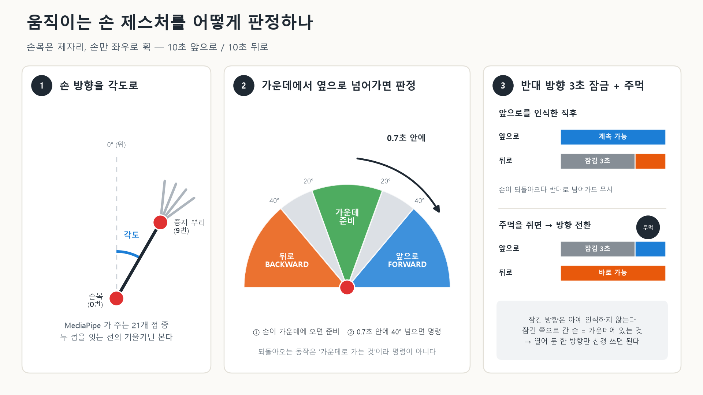

# 실시간 손 제스처 인식 기반 동영상 제어 시스템

Real-Time Hand Gesture Recognition-Based Video Control System

웹캠으로 손의 **움직임**을 인식해 동영상 제어 명령(10초 앞으로 / 10초 뒤로 등)으로 바꾸는 컴퓨터비전 팀프로젝트입니다.
Python · OpenCV(웹캠 입력·화면 표시) · MediaPipe Hand Landmarker(손 랜드마크 21개)를 사용합니다.

> 현재 버전은 **동적 제스처 인식 실험판**입니다. 인식 결과를 화면과 터미널에 보여 주며, 유튜브 제어 연결은 아직 들어 있지 않습니다.
> 유튜브 제어가 포함된 이전 통합 버전은 커밋 `4975940` 에서 볼 수 있습니다.



## 설치 · 실행

```powershell
py -m venv .venv
.\.venv\Scripts\python.exe -m pip install -r requirements.txt
.\.venv\Scripts\python.exe src\hand_tracking.py
```

끝내기: 웹캠 창에서 `ESC`

## 제스처

| 동작 | 결과 |
|---|---|
| 한 손 브이(V) 1초 유지 | 인식 시작 / 종료 (`CONTROL_ON` / `CONTROL_OFF`) |
| 한 손 OK 사인 | `PLAY_PAUSE` |
| 손을 세운 자세(가운데)에서 **오른쪽으로 휙** | `SEEK_FORWARD` |
| 손을 세운 자세(가운데)에서 **왼쪽으로 휙** | `SEEK_BACKWARD` |
| 주먹 0.25초 | 방금 방향을 잠그고 반대 방향을 푼다 (방향 전환) |

좌우는 사용자 기준입니다(화면이 거울처럼 반전됨). 왼손·오른손 모두 됩니다.
손목은 거의 제자리에 두고 손만 좌우로 젖히는 동작입니다.

## 동적 제스처를 어떻게 판정하나

정적 자세는 한 프레임의 손 모양만 보면 되지만, 동적 제스처는 **시간에 따른 랜드마크 변화**를 봐야 합니다. (`src/swing_tracking.py`)

1. **손 방향** = 손목(0번) → 중지 뿌리(9번) 벡터의 각도. 0° = 위, + = 오른쪽.
2. **가운데 → 좌/우**: 손이 가운데(±20°)에 있으면 준비 상태가 되고, 0.7초 안에 한쪽으로 40° 이상 넘어가면 그 방향으로 판정한다. 가운데로 되돌아오는 동작은 준비일 뿐 명령이 아니다.
3. **손 놓침 허용**: 빠르게 휘두르면 모션 블러로 1~3프레임 손 검출이 끊긴다. 0.4초 이하 공백은 같은 동작으로 이어서 본다.
4. **손목 고정 확인**: 손목 이동이 손 크기(0→9번 거리)의 1.5배 이하일 때만 인정한다. 손 전체를 옮기는 동작과 구분하기 위해서다.

### 반대 방향 3초 규칙 + 주먹

한쪽으로 친 뒤 손이 되돌아오다 반대쪽으로 넘어가면 반대 명령으로 잘못 잡힐 수 있다. 그래서:

- 한 방향이 인식되면 **반대 방향은 3초 동안 잠근다.** 같은 방향은 계속 가능하다.
- **주먹을 쥐면** 방금 방향을 3초 잠그고 반대 방향을 바로 푼다.
- **잠긴 방향은 아예 인식하지 않는다.** 잠긴 쪽으로 간 손은 '가운데'와 같게 취급하므로, 잠긴 쪽으로 손을 뺐다가 열린 쪽으로 치면 그대로 인식된다.

## 화면 표시

- 오른쪽 위: FPS, 손 검출 1회 소요 시간(ms), 방향별 가능 / 잠김 남은 초
- 오른쪽 아래: 최근 인식된 명령 5개 (최신이 맨 아래)
- 손 아래: 현재 손 각도와 준비 상태 (`READY` / `go center`)

실행할 때마다 `traces/` 에 프레임별 기록(CSV: 손 각도, 손목 위치, 판정 결과)이 남습니다. 기준값을 조정할 때 근거로 씁니다.

## 측정 결과 (개발 노트북: Intel i5-8265U, 웹캠 640×480 30FPS)

- 처리 속도 약 17~22 FPS — 손 검출이 프레임당 30~45ms 로 병목 (카메라는 30FPS 정상)
- 마지막 테스트: 스윙 판정 26회, **방향 오류 0회**, 미인식 3회 (가운데 프레임이 블러로 한 장도 안 잡힌 경우)

| 단계 | 인식 | 원인 → 수정 |
|---|---|---|
| 각도 변화만 보는 첫 판 | 0건 | 스윙 도중 손을 놓칠 때마다 기록이 지워짐 → 짧은 공백은 이어서 판정 |
| 가운데 → 좌/우 | 32% | 가운데 0.15초 체류 조건이 과함 → 가운데 프레임 1장이면 준비 |
| 조건 완화 | 69% | 잠긴 방향의 판정이 건 쿨다운이 본 동작을 삼킴 → 잠긴 방향은 인식하지 않음 |
| 현재 | 약 90%, 방향 오류 0 | |

## 조정할 수 있는 값

| 위치 | 값 | 의미 |
|---|---|---|
| `SwingTracker` | `center_zone=20` | 가운데로 보는 각도 범위(±도) |
| | `trigger_angle=40` | 이 각도 이상 넘어가면 판정 |
| | `swing_time=0.7` | 가운데를 떠난 뒤 판정까지 허용 시간(초) |
| | `gap_max=0.4` | 손을 놓쳐도 이어서 보는 최대 공백(초) |
| | `wrist_drift_max=1.5` | 손목 이동 허용(손 크기 배수) |
| `SeekGate` | `block_time=3.0` | 반대 방향 잠금 시간(초) |
| | `fist_hold=0.25` | 주먹 인정 시간(초) |
| `hand_tracking.py` | `ENABLE_VOLUME=False` | 위/아래 이동 볼륨. 좌우 시험 중이라 꺼 둠 |

## 파일

| 파일 | 설명 |
|---|---|
| `src/hand_tracking.py` | 웹캠 입력, 손 검출, 판정 통합, 화면 표시 |
| `src/gesture_recognition.py` | V · OK · 주먹 판정, 명령 우선순위, 시작/종료 상태 |
| `src/motion_tracking.py` | 손 이동 추적(쿨다운, 위/아래 이동) |
| `src/swing_tracking.py` | 가운데→좌/우 스윙 판정, 3초/주먹 규칙, 프레임 기록 |
| `models/hand_landmarker.task` | MediaPipe 손 랜드마크 모델 |

## 출처

`hand_tracking.py` · `gesture_recognition.py` · `motion_tracking.py` 는 팀원 저장소
[junseop02/gesture_video_controller](https://github.com/junseop02/gesture_video_controller) (커밋 `5fbea41`)를 바탕으로 했습니다.
그 위에 FPS 표시, 명령 로그, 스윙 판정(`swing_tracking.py`), 3초/주먹 규칙을 더했습니다.
